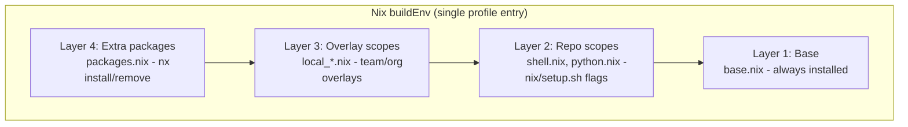

# Customization

The tool is designed for customization at three levels - from individual developers adding a package to organizations distributing standardized environments - without forking the base repository.

## Package layers

Packages are assembled from four layers, evaluated bottom-up by the Nix flake. All layers merge into a single `buildEnv` - one nix profile entry, one `nix profile upgrade` to apply. No layer can shadow or break another.



| Layer              | What                                           | How                                 | Who        |
| ------------------ | ---------------------------------------------- | ----------------------------------- | ---------- |
| **Base**           | Core tools (git, jq, curl, coreutils)          | Always included, cannot be disabled | Base repo  |
| **Repo scopes**    | Curated groups (shell, python, k8s, terraform) | `nix/setup.sh --shell --python`     | Base repo  |
| **Overlay scopes** | Custom groups (team CLIs, org utilities)       | `nx scope add` or overlay directory | Team / org |
| **Extra packages** | Individual tools                               | `nx install httpie`                 | Individual |

## Adding packages (layer 4)

The simplest way - no scopes, no files to edit:

```bash
nx install httpie jq       # validates against nixpkgs, installs immediately
nx remove httpie           # remove a package
nx list                    # see everything installed, annotated by layer
```

Package names are validated against nixpkgs before being added. Typos and non-existent packages are caught immediately. Changes apply without needing `nx upgrade`.

Use this for one-off tools. If you find yourself adding many related packages, consider creating a scope instead.

## Creating custom scopes (layer 3)

Scopes group related packages with a meaningful name:

```bash
# Create a scope and add packages in one step
nx scope add devtools httpie jq bat

# Add more packages to an existing scope
nx scope add devtools fd

# Open a scope in your editor
nx scope edit devtools

# Apply changes after manual edits
nx upgrade
```

The scope file is standard Nix:

```nix
{ pkgs }: with pkgs; [
  bat
  fd
  httpie
  jq
]
```

Scopes created via `nx scope add` live in your personal overlay directory (`~/.config/nix-env/local/`) and are copied into `~/.config/nix-env/scopes/` with a `local_` prefix - preventing name collisions with base repo scopes.

### Packages that are not in nixpkgs

A scope file is an ordinary Nix function: it takes `pkgs` and returns a list of
derivations. The flat package list is only the shape `nx scope add` writes - it
is not a restriction. You can build a derivation inline and return that, which
is how an overlay ships a tool nixpkgs does not carry without changing this
repo.

This example installs a prebuilt release binary, so it costs a download instead
of a source build:

```nix
{ pkgs }:
let
  version = "0.28.4";
  sofka = pkgs.stdenvNoCC.mkDerivation {
    pname = "sofka";
    inherit version;
    src = pkgs.fetchurl {
      url = "https://github.com/nklmilojevic/sofka/releases/download/v${version}"
        + "/sofka-v${version}-x86_64-unknown-linux-musl.tar.gz";
      sha256 = "72b5b56afc3cb021d5233a63b6d252a4b8375c420a887da1e58be803cafdae0b";
    };
    sourceRoot = ".";
    installPhase = ''
      runHook preInstall
      install -Dm755 sofka "$out/bin/sofka"
      runHook postInstall
    '';
  };
in
[ sofka ]
```

Things worth knowing:

- Prefer a statically linked release asset - a `musl` build on Linux. A
  dynamically linked binary also needs `pkgs.autoPatchelfHook` in
  `nativeBuildInputs` and its shared libraries in `buildInputs`.
- `sourceRoot = "."` is for a flat archive that has no top-level directory.
- This example pins one platform. To cover several, look the URL and hash up in
  an attribute set keyed on `pkgs.stdenv.hostPlatform.system`.
- `nx scope add` cannot add such a package, because it checks every name
  against nixpkgs. Create the scope with `nx scope add <name>`, then write the
  derivation with `nx scope edit <name>`.
- After a scope file contains hand-written Nix, `nx scope add <name> <pkg>`
  refuses to touch it. That command rebuilds the file from package names alone
  and would discard everything else. Edit the file directly instead.

## Overlay directory

An overlay directory holds scopes, shell config and post-setup hooks that sit on top of the standard scopes.
To write an overlay for a team or build an image on one, see [Overlays](overlays.md).
Two overlays can be active at once, and setup applies both:

| Overlay      | Location                         | Owned by                    |
| ------------ | -------------------------------- | --------------------------- |
| Organization | set with `nx overlay set <path>` | a team or org, or an image  |
| Personal     | `~/.config/nix-env/local/`       | you, through `nx scope add` |

Setup reads the org overlay first, then the personal one. Setup creates neither directory; `nx scope add`
creates the personal one.

### Structure

```text
overlay-dir/
├── scopes/                       # scope files, copied in as local_<name>.nix
│   └── devtools.nix
├── shell_cfg/                    # extra shell config, sourced at login
│   └── aliases_custom.sh
└── hooks/
    └── post-setup.d/             # scripts run after setup
        └── npm-globals.sh
```

A scope file is installed because it is there. Every setup run copies it in as `local_<name>.nix` and
enables it, and deleting it from the overlay removes the scope on the next run.

A scope file can also name the standard scopes it needs, in a `# scopes:` header:

```nix
# scopes: python nodejs gcloud k8s_base
# bins: btop psql
{ pkgs }: with pkgs; [
  btop
  postgresql
]
```

Setup enables those scopes as if they were passed as flags, with their dependencies and install steps.
An unknown name prints a warning and is skipped. When a name drops out of the header, setup removes that
scope once, with its remove step, and prints it. On an unattended run that step deletes the scope's
home folder too, for example `~/google-cloud-sdk` for `gcloud`. A user who adds the scope back keeps it.

### What the organization overlay controls

The org overlay is the target state for what it provides, so the people who own it decide what is
installed, and every machine picks up their change on its next setup run:

- `nx scope remove` and `nix/setup.sh --remove` refuse a scope the org overlay provides, including the
  standard scopes its headers name, and say which file provides it.
- `nx scope add`, `nx scope edit` and scope flags for a scope it already provides change nothing and say so.
- A personal scope file with the same name as an org one is ignored with a warning.
- Shell config is the exception: a personal `shell_cfg/` file replaces an org file of the same name.

For a scope in your personal overlay, `nx scope remove` deletes the file, and a scope named in your own
header is removed by editing that header.

### Building an image on an overlay

A container image can bake an overlay in and run setup with no scope flags, at build time and on every
start. [Overlays](overlays.md#building-an-image-on-an-overlay) has the recipe.

### Sharing with a team

Keep the overlay in a shared git repo. Each team member then runs these steps once:

```bash
git clone https://github.com/<org>/team-nix-overlay ~/src/team-nix-overlay
nx overlay set ~/src/team-nix-overlay   # remembered in ~/.config/nix-env/overlay_dir
nx setup                                # installs the overlay's scopes
```

`NIX_ENV_OVERLAY_DIR`, when set, takes precedence over the saved path. To stop using the overlay, run
`nx overlay unset` and drop the variable if you set it; the next `nx setup` removes its scopes.

To pick up changes later, `git pull` in the overlay and run `nx setup`. It also runs the install steps of a
scope a header adds, such as the gcloud CLI, which `nx upgrade` skips. The clone is a known gap - [`design/overlay_catalog.md`](https://github.com/szymonos/envy-nx/blob/main/design/overlay_catalog.md)
proposes a one-command `nx overlay add` that replaces it.

### Managing overlays

```bash
nx overlay              # both directories: scopes, header scopes, shell config, hooks and sync status
nx overlay set <path>   # use <path> as the organization overlay
nx overlay unset        # stop using it
```

## Hooks

Hook scripts (`*.sh`) run at defined phases during `nix/setup.sh`.

Per-machine hooks live in `~/.config/nix-env/hooks/`. They are sourced into setup, so they can read and
change its variables:

| Phase      | Directory                               | Variables available                              |
| ---------- | --------------------------------------- | ------------------------------------------------ |
| Pre-setup  | `~/.config/nix-env/hooks/pre-setup.d/`  | `NIX_ENV_VERSION`, `NIX_ENV_PLATFORM`, `ENV_DIR` |
| Post-setup | `~/.config/nix-env/hooks/post-setup.d/` | All above + `NIX_ENV_SCOPES`                     |

Overlay hooks in `<overlay>/hooks/post-setup.d/` run after the per-machine post-setup hooks, org overlay
first. Each runs as its own `bash` process with `ENV_DIR`, `NIX_ENV_PLATFORM` and `NIX_ENV_SCOPES` set,
and with PATH covering the nix profile, `~/.local/bin`, fnm's default Node and `~/google-cloud-sdk/bin`, so it can call `npm`,
`uv` or `gcloud`. A hook that fails prints a warning and setup finishes. Overlays have no pre-setup hooks.

Hooks run on every setup run, so make them safe to repeat:

```bash
# <overlay>/hooks/post-setup.d/npm-globals.sh
v=5.6.3
npm ls -g "typescript@$v" >/dev/null 2>&1 || npm install -g "typescript@$v"
```

Deleting a hook stops it running; what it installed stays.

Example use cases:

- **VPN check** - verify VPN is connected before setup downloads packages
- **Fleet telemetry** - POST `install.json` to a monitoring endpoint after setup
- **Team pinning** - write `pinned_rev` to lock package versions across a team
- **Compliance** - verify required scopes are present, block setup if missing

## Pinning package versions

By default, `nx upgrade` moves to the CI-validated `nixpkgs-unstable` revision - a deterministic snapshot of 100k+ packages at specific versions. Each commit is a reproducible state, not a rolling release.

For teams that need coordinated versions:

```bash
nx upgrade           # upgrade and verify everything works
nx pin set           # pin the current (tested) revision
nx pin show          # show current pin
nx pin remove        # go back to the validated revision
```

The pin is stored in `~/.config/nix-env/pinned_rev`. When present, `nx upgrade` locks to that commit instead of the validated revision. Set the pin from a pre-setup hook on each machine (placed there by your device management, for example):

```bash
# ~/.config/nix-env/hooks/pre-setup.d/pin_nixpkgs.sh
echo "abc123..." > "$HOME/.config/nix-env/pinned_rev"
```

When IT validates a new nixpkgs revision, they update the hook - every machine gets the tested baseline on its next setup run.

## Upgrades and rollback

```bash
nx upgrade                    # upgrade all packages to latest (or pinned) versions
nx rollback                   # revert to the previous package set
nix profile diff-closures     # see exactly what changed
nx gc                         # clean up old generations
```

Upgrades are atomic - all packages upgrade together through a single `buildEnv`. Rollback reverts the entire environment to the previous state, not individual packages. This eliminates partial upgrade states.

## Quick reference

| Task                         | Command                              |
| ---------------------------- | ------------------------------------ |
| Add a package                | `nx install <pkg>`                   |
| Remove a package             | `nx remove <pkg>`                    |
| List all packages            | `nx list`                            |
| Search nixpkgs               | `nx search <term>`                   |
| Create a scope with packages | `nx scope add <name> <pkg> [pkg...]` |
| Edit a scope file            | `nx scope edit <name>`               |
| Show scope tree              | `nx scope tree`                      |
| Show overlays and sync state | `nx overlay`                         |
| Upgrade packages             | `nx upgrade`                         |
| Pin current revision         | `nx pin set`                         |
| Show / remove pin            | `nx pin show` / `nx pin remove`      |
| Roll back last upgrade       | `nx rollback`                        |
| See what changed             | `nix profile diff-closures`          |
| Clean up old generations     | `nx gc`                              |
| Run health checks            | `nx doctor`                          |
